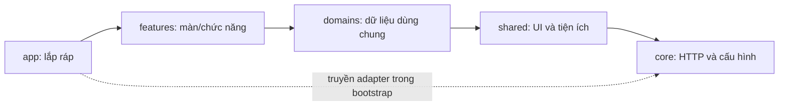
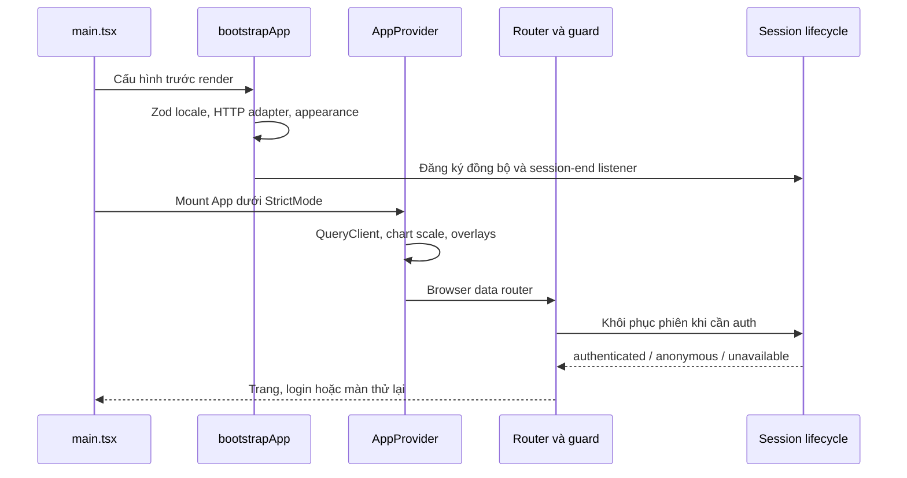
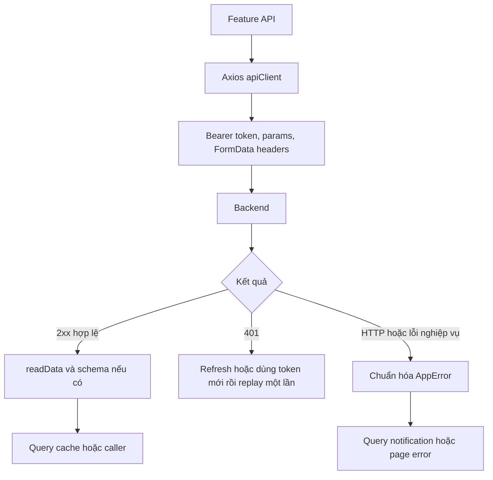
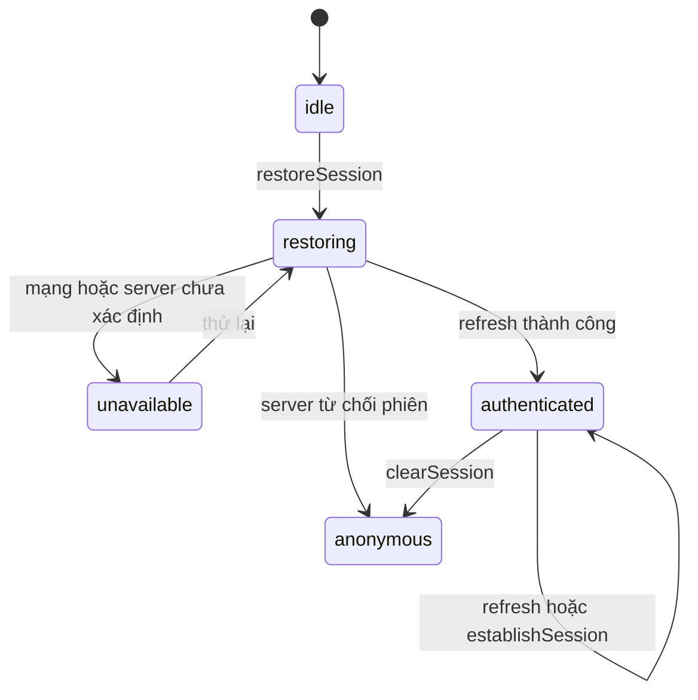

# Phân tích source-base: chức năng, kiến trúc và hướng tối ưu

**Ngày khảo sát:** 07/10/2026, múi giờ Việt Nam.  
**Source được phân tích:** `D:\tc-dashboard\source-base`.  
**Phạm vi:** bộ khung React ở thư mục trên; không phải source Dashboard tại `dashboard/tc-dashboard`.  
**Kết quả bàn giao:** tài liệu phân tích; không triển khai các đề xuất, không sửa code ứng dụng.

## Mục lục

1. [Kết luận và thứ tự ưu tiên](#1-kết-luận-và-thứ-tự-ưu-tiên)
2. [Phạm vi, phương pháp và kiểm chứng](#2-phạm-vi-phương-pháp-và-kiểm-chứng)
3. [Công nghệ và quy mô source](#3-công-nghệ-và-quy-mô-source)
4. [Cấu trúc thư mục và trách nhiệm](#4-cấu-trúc-thư-mục-và-trách-nhiệm)
5. [Luồng khởi động và provider](#5-luồng-khởi-động-và-provider)
6. [Router, module, điều hướng và quyền](#6-router-module-điều-hướng-và-quyền)
7. [Shell, layout và các trang có sẵn](#7-shell-layout-và-các-trang-có-sẵn)
8. [HTTP, hợp đồng API và xử lý lỗi](#8-http-hợp-đồng-api-và-xử-lý-lỗi)
9. [Phiên đăng nhập và phân quyền](#9-phiên-đăng-nhập-và-phân-quyền)
10. [Các chức năng xác thực](#10-các-chức-năng-xác-thực)
11. [State, cache, URL và lưu trữ](#11-state-cache-url-và-lưu-trữ)
12. [UI kit: chức năng của từng nhóm](#12-ui-kit-chức-năng-của-từng-nhóm)
13. [Form và validation](#13-form-và-validation)
14. [Bảng, cây và dữ liệu lớn](#14-bảng-cây-và-dữ-liệu-lớn)
15. [Ảnh, upload và tác vụ nền](#15-ảnh-upload-và-tác-vụ-nền)
16. [Widgets và charts](#16-widgets-và-charts)
17. [Theme, token, responsive và TV](#17-theme-token-responsive-và-tv)
18. [Hook và tiện ích dùng chung](#18-hook-và-tiện-ích-dùng-chung)
19. [Các màn demo và phần chưa nối backend](#19-các-màn-demo-và-phần-chưa-nối-backend)
20. [Build, lint, test và CI](#20-build-lint-test-và-ci)
21. [Các vấn đề cần sửa trước](#21-các-vấn-đề-cần-sửa-trước)
22. [Các hướng tối ưu hiệu năng](#22-các-hướng-tối-ưu-hiệu-năng)
23. [Các điểm bổ sung cần rà soát](#23-các-điểm-bổ-sung-cần-rà-soát)
24. [Lộ trình cải thiện và tiêu chí nghiệm thu](#24-lộ-trình-cải-thiện-và-tiêu-chí-nghiệm-thu)
25. [Hướng sử dụng base cho dự án thật](#25-hướng-sử-dụng-base-cho-dự-án-thật)
26. [Từ điển thuật ngữ và nguồn tham chiếu](#26-từ-điển-thuật-ngữ-và-nguồn-tham-chiếu)

## 1. Kết luận và thứ tự ưu tiên

Base này đã có nền tảng tương đối đầy đủ để xây một React SPA: UI kit riêng, form, bảng, cây, biểu đồ, khung ứng dụng, đăng nhập, quản lý phiên, phân quyền phía giao diện, HTTP, cache, theme, mobile và chế độ TV. Các tầng có ranh giới rõ và nhiều quy ước được kiểm bằng công cụ. Không có căn cứ để viết lại toàn bộ kiến trúc hoặc thay hàng loạt thư viện.

Tuy nhiên, base chưa phải một sản phẩm nghiệp vụ hoàn chỉnh. Dashboard dự án, danh sách gói thầu và dashboard xưởng là màn trình diễn với dữ liệu mẫu. Đăng nhập và các chức năng xác thực gọi endpoint thật, nên cần backend phù hợp. Hồ sơ hiện chỉ đọc; ProgressCenter không tự tạo hay thực thi công việc phía server.

Thứ tự nên làm:

| Ưu tiên | Việc | Lý do |
|---|---|---|
| P1 — trước khi dùng với dữ liệu thật | Ngăn request của tài khoản A được phát lại bằng token tài khoản B | Sai ngữ cảnh người dùng ở request, đặc biệt với mutation |
| P1 — trước khi dùng với dữ liệu thật | Không log nguyên lỗi form chứa `AxiosError.config.data` | Có thể để mật khẩu/token xuất hiện trong console hoặc công cụ thu log |
| P2 — sửa hành vi nền tảng | Xem lại logout, giới hạn upload, đồng bộ reset-password/FileField, chờ Web Locks | Giảm lỗi bất đồng bộ và dữ liệu cũ |
| P2 — cải thiện trải nghiệm | Bổ sung bảo vệ submit ở handler; kiểm picker, bàn phím, label/focus | Base được tái dùng nên lỗi nhỏ ảnh hưởng nhiều màn |
| P2 — tối ưu có đo đạc | Registry icon, tải `/demo`, CSS header, bảng/upload lớn | Bundle hiện có gần ngân sách; không nên tăng ngưỡng tùy tiện |
| P3 — khi chuẩn bị phát hành | Branding, icon PWA, tương thích browser, tài liệu lệch code | Hoàn thiện tích hợp và giảm chi phí bảo trì |

P1/P2/P3 là thứ tự ưu tiên của khảo sát này, không phải xác nhận đã có sự cố trên production. Những điểm liên quan dữ liệu lớn chỉ cần triển khai khi luồng sử dụng thực sự có nhu cầu đó.

## 2. Phạm vi, phương pháp và kiểm chứng

### 2.1 Đã khảo sát những gì

- Entry, bootstrap, provider, router, guard, module registry, layout, shell và các trang tĩnh.
- Tầng cấu hình, HTTP, lỗi, QueryClient; domain session/preferences; auth API, schema và page.
- Public API của UI kit, hook, chart, widget; cơ chế form, bảng, cây, upload, ảnh và tác vụ nền.
- Token màu/chữ, CSS, responsive, TV, registry asset; script generate và kiểm bundle.
- Cấu hình TypeScript/ESLint/Vitest, hook Git, CI; đối chiếu README và `docs/known-issues.md` với code.

Đây là khảo sát kiến trúc và các luồng quan trọng, kèm catalog theo nhóm. Không có nghĩa từng dòng trong hơn 800 file TypeScript đã được chứng minh đúng trong mọi tình huống.

Source được đọc theo **working tree tại thời điểm khảo sát**. Có một thay đổi sẵn trong `src/shared/widgets/header/header-skin.store.ts`; khảo sát không ghi đè thay đổi đó. Artifact `dist` tồn tại trước khảo sát nên được coi là số đo tham khảo của artifact, không coi là build của source hiện tại.

### 2.2 Kết quả đã chạy

Các lệnh được gọi từ thư mục làm việc Dashboard, dùng `npm --prefix D:/tc-dashboard/source-base` để chọn đúng package cần khảo sát. Không lấy kết quả kiểm tra của Dashboard để gán cho base.

| Kiểm tra | Kết quả thực tế | Phạm vi kết luận |
|---|---|---|
| `npm --prefix D:/tc-dashboard/source-base run typecheck` | Đạt, exit code 0 | Các project TypeScript cấu hình cho base |
| `npm --prefix D:/tc-dashboard/source-base run lint` | Đạt, exit code 0 | ESLint toàn package, không cho warning |
| `npm --prefix D:/tc-dashboard/source-base run test:unit` | 118 file, **1.879 test đạt** | Test đơn vị và test policy, Vitest/jsdom |
| `npm --prefix D:/tc-dashboard/source-base run test:smoke` | 5 file, **25 test đạt** | Dựng cây giao diện trong jsdom |
| `node D:/tc-dashboard/source-base/scripts/check-bundle.mjs D:/tc-dashboard/source-base/dist` | Đạt ngân sách | Chỉ artifact `dist` đã có |
| Mô phỏng interceptor đổi tài khoản | Request A bị replay bằng token B; xem §21.1 | Source interceptor thật, Axios thật, network adapter giả |
| Mô phỏng submit form liên tiếp | onSubmit chạy hai lần trước khi settle; xem §21.10 | Form source/RHF thật, render/draft/guard được stub |
| Mẫu tối thiểu router dưới StrictMode | Tạo 2 router, thêm 2 listener `popstate`; xem §21.11 | Cấu trúc khởi tạo tương đương trong development |

Tổng cộng **123 file test, 1.904 test đạt**. Kết quả xanh không thay thế các regression test còn thiếu nêu trong báo cáo.

### 2.3 Chưa kiểm chứng trong lần này

Không build lại, không chạy `check:all`, không chạy coverage mới, không xác nhận pipeline CI trên remote. Không sửa generator hay chạy ⛔ `generate:icons`/`generate:images`. Không đo Lighthouse, Web Vitals, heap hoặc render duration trên trình duyệt thật; không kiểm trực tiếp iPhone/iPad/WebView; không thử backend production.

Vì vậy không đưa ra tỷ lệ coverage mới, tốc độ tải theo giây, số người dùng đồng thời hay kết luận về cookie/CORS/backend. Các nhận định hiệu năng dưới đây mô tả cơ chế và số đo bundle hiện có; lợi ích tối ưu phải đo lại sau khi thực hiện.

## 3. Công nghệ và quy mô source

### 3.1 Công nghệ được khai trong package

Nguồn: [package.json](package.json), [vite.config.ts](vite.config.ts).

| Thành phần | Phiên bản/nhóm khai báo | Vai trò |
|---|---|---|
| React / React DOM | `^19.2.0` | Render và vòng đời UI |
| TypeScript | `~5.9.3`, strict | Kiểm kiểu ứng dụng, test và config |
| Vite | `^8.2.2` | Dev server, build; cấu hình chia chunk Rolldown |
| Tailwind CSS | `^4.2.1` | Utility CSS, token và custom variant |
| Radix UI | Các package riêng | Hành vi dialog, popover, select, tooltip, menu, toast… |
| React Router DOM | `^7.13.1` | Browser data router, route lồng, blocker |
| TanStack Query | `^5.90.21` | Cache dữ liệu server, query/mutation |
| Zustand | `^5.0.11` | Session/preferences và trạng thái widget |
| Axios | `^1.13.6` | HTTP, interceptor, cookie, hủy request |
| React Hook Form + Zod | `^7.71.2` + `^4.3.6` | Form và runtime validation |
| Recharts | `^3.8.1` | Biểu đồ ở các màn sử dụng |
| react-arborist | `^3.16.0` | Cây dữ liệu có ảo hóa |
| dnd-kit | core/sortable/utilities | Kéo thả dòng bảng và field array |
| react-number-format / dayjs | Theo package | Nhập số có format, thao tác ngày giờ |
| Vitest / Testing Library / jsdom | Theo package | Test đơn vị, component và smoke |
| ESLint / Prettier / knip / madge / husky | Theo package | Lint, format, code thừa, import vòng, Git hooks |

Các con số trên là **range khai báo**, không phải tất cả phiên bản đã resolve trong `node_modules`. Môi trường khảo sát dùng Node `v24.19.0`, npm `11.17.0`; Vitest hiển thị `4.1.11` khi chạy test. `.nvmrc` chọn Node 24, `.npmrc` bật `engine-strict=true`.

**Khác Dashboard:** base không khai `antd` hoặc `tailwind-variants`; biến thể UI chủ yếu dùng bảng class `*_CLASSES` và `cn()`. Component bảng tên `Table`, chọn danh sách tên `Dropdown`. Header dùng slot và nhiều skin. Không dùng quy tắc tên component hoặc layout riêng của Dashboard để kết luận những lựa chọn này là lỗi của base.

### 3.2 Quy mô tại thời điểm khảo sát

| Nhánh trong `src` | Số file |
|---|---:|
| `app` | 74 |
| `core` | 17 |
| `domains` | 24 |
| `features` | 154 |
| `shared` | 532 |
| `assets` | 382 |
| `styles` | 19 |
| `main.tsx` + `vite-env.d.ts` | 2 |
| **Tổng** | **1.204** |

Có **801 file `.ts`/`.tsx`**, khoảng **76.584 dòng** tính bằng đọc file tại thời điểm khảo sát, bao gồm code sinh tự động, khai báo kiểu, comment và dòng trống. Có **377 SVG icon**. Các file generated lớn gồm icon component registry 7.534 dòng, color TS 811 dòng và icon name registry 767 dòng.

Số file nhiều chủ yếu đến từ UI kit, parts/theme/types, demo và asset. Không thể dùng số file hoặc số dòng đơn lẻ làm bằng chứng kiến trúc kém hay app chậm.

## 4. Cấu trúc thư mục và trách nhiệm

```text
source-base/
├── src/
│   ├── main.tsx             Entry trình duyệt
│   ├── app/                 Lắp ráp ứng dụng cụ thể
│   │   ├── bootstrap.ts     Nối HTTP, session, appearance, cleanup
│   │   ├── components/      Loading/error screens, ErrorBoundary
│   │   ├── layouts/         RootLayout, AuthLayout, AppShellLayout
│   │   ├── providers/       Query, appearance, chart scale, overlays
│   │   ├── router/          Registry, route builder, guards, menu, sync
│   │   ├── shell/           Nối widgets với session và navigation
│   │   └── pages/           Home, Profile, Settings, status, placeholder
│   ├── features/
│   │   ├── auth/            Đăng nhập/đăng ký/quên/reset mật khẩu
│   │   └── demo/            Library, composed, dashboard, factory
│   ├── domains/
│   │   ├── session/         Dữ liệu phiên, quyền, API, lifecycle
│   │   └── preferences/     Theme, TV, mức phóng chữ
│   ├── shared/
│   │   ├── ui/              UI kit theo nhóm chức năng
│   │   ├── widgets/         Header, Dock, TabBar, palette, progress
│   │   ├── charts/          Hạ tầng màu/mật độ/trục/nhãn/scale
│   │   ├── hooks/           Hook dùng lại, không biết nghiệp vụ
│   │   ├── utils/           Format, browser, validation, style
│   │   ├── constants/       Path, layout, pagination, media query
│   │   └── theme/           Color TS sinh từ JSON
│   ├── core/                Config, HTTP, Query factory
│   ├── styles/              Token, base CSS, utilities, overrides, TV
│   └── assets/              Icon SVG và registry ảnh
├── tests/                   Test app/core/domain/UI và policy
├── scripts/                 Generate và các cổng kiểm chất lượng
├── docs/                    Kiến trúc, rule, note, hướng dẫn, known issues
├── public/                  Favicon, manifest
└── .github/workflows/       CI hai chế độ demo/app
```

Chiều phụ thuộc thiết kế:



Các tầng trên có thể dùng API công khai của tầng thấp hơn theo quy tắc ESLint; sơ đồ thể hiện hướng tổng quát, không yêu cầu mọi import phải đi qua đủ năm bước. `core` không cần import store/router/UI: auth adapter và thông báo được truyền từ tầng app.

### Cách đọc một cụm component

| Loại file | Ý nghĩa |
|---|---|
| `Component.tsx` | Render và phối hợp hành vi của component |
| `*.types.ts` | Props, kiểu dữ liệu và union variant |
| `*.theme.ts` | Bảng class/token theo biến thể |
| `hooks/` | Logic state, interaction, async có thể tách khỏi JSX |
| `parts/` | Thành phần nội bộ của một component lớn |
| `utils/` | Hàm thuần biến đổi/tính toán |
| `index.ts` | API công khai để các vùng khác import |

Tách như vậy giúp sửa màu/bố cục mà không phải sửa API hay logic dữ liệu. Không cần chia file tiếp chỉ để giảm số dòng nếu phần mới không có trách nhiệm độc lập.

## 5. Luồng khởi động và provider

Nguồn: [main.tsx](src/main.tsx), [App.tsx](src/app/App.tsx), [bootstrap.ts](src/app/bootstrap.ts), [AppProvider.tsx](src/app/providers/AppProvider.tsx).



### 5.1 `main.tsx`

Nạp CSS toàn cục, tìm `#root`, gọi bootstrap rồi mount React. Có `StrictMode` để phát hiện vấn đề effect/lifecycle trong development. Lỗi đồng bộ trong vùng bootstrap được hiển thị bằng màn lỗi. Lỗi xảy ra ngay khi đánh giá static import có thể xảy ra trước vùng `try`; đây là giới hạn nhỏ của startup fallback, không phải mọi lỗi đều được catch tại entry.

### 5.2 `bootstrapApp()`

- Cấu hình thông báo validation tiếng Việt.
- Nối Axios với hàm đọc access token và refresh session.
- Áp theme/TV trước render để hạn chế chớp giao diện sai theme.
- Nghe kết thúc phiên/đổi tài khoản để clear Query cache và reset ProgressCenter.
- Bật đồng bộ session giữa tab.
- Trả disposer để gỡ listeners và HTTP configuration; HMR dùng disposer.

Bootstrap có bảo vệ gọi trùng. Đây là điểm tốt: setup nằm một chỗ và các tầng thấp không phụ thuộc ngược lên app.

### 5.3 `App` và `AppProvider`

`App` bọc ranh giới lỗi và Suspense. Provider cấp QueryClient, đồng bộ appearance, cấp scale cho chart và gắn overlay xuyên route. Có thể truyền QueryClient riêng vào provider để cô lập test. Toast và tiến trình không cần gắn lại ở từng page.

## 6. Router, module, điều hướng và quyền

Nguồn: [static.routes.ts](src/app/router/static.routes.ts), [module-registry.ts](src/app/router/modules/module-registry.ts), [demo.routes.ts](src/app/router/modules/demo.routes.ts), [app-routes.tsx](src/app/router/setup/app-routes.tsx).

### 6.1 Các URL có sẵn

| URL | Chức năng | Điều kiện/layout |
|---|---|---|
| `/login` | Đăng nhập | GuestGuard + AuthLayout |
| `/register` | Đăng ký | GuestGuard + AuthLayout |
| `/forgot-password` | Yêu cầu đặt lại mật khẩu | GuestGuard + AuthLayout |
| `/reset-password` | Đặt mật khẩu bằng token URL | GuestGuard + AuthLayout |
| `/` | Trang chủ và gợi ý dùng base | AuthGuard + AppShellLayout |
| `/profile` | Xem profile từ session | AuthGuard + AppShellLayout |
| `/settings` | Theme, TV, phóng chữ | AuthGuard + AppShellLayout |
| `/403` | Không có quyền | Ngoài auth/guest guards, trong RootLayout |
| `/404` | Không tìm thấy trang | Ngoài auth/guest guards, trong RootLayout |
| `*` | Redirect sang `/404` | Catch-all, replace history |
| `/demo` | Thư viện UI | Chỉ đăng ký ở demo mode |
| `/demo/ghep` | Gói thầu mẫu | Chỉ đăng ký ở demo mode |
| `/demo/tong-quan` | Dashboard dự án mẫu | Chỉ đăng ký ở demo mode |
| `/demo/xuong` | Dashboard xưởng mẫu | Chỉ đăng ký ở demo mode |

Demo mặc định tắt kiểm đăng nhập. Vì vậy việc route nằm dưới `AuthGuard` không đồng nghĩa cần đăng nhập trong bản demo. Khi chuyển `VITE_APP_MODE=app`, demo module không được đăng ký và auth mặc định bật.

### 6.2 Module registry

`ModuleDef` mô tả ID, path, metadata, quyền, page/layout và route con. Registry được dùng để dựng route, tên trang, menu module, Dock và Command Palette. Quyền mặc định của module là `module.id:view`; cấu hình `'authenticated'` chỉ yêu cầu phiên đăng nhập.

Route builder dựng cây lồng. Guard cha/con cùng áp dụng theo cây, nên trang con không bỏ qua quyền cha. Dev validation kiểm ID/path trùng, cấu trúc route sai, index page và default tab thiếu. Đây là nền tảng nên giữ khi thêm nghiệp vụ.

### 6.3 Lazy load và preload

`lazyPage()` gói React.lazy kèm `preload()`. Hover/focus/ý định điều hướng có thể nạp page sớm; preload và render dùng chung promise. Page có ranh giới tải/lỗi. Các màn status quan trọng được nạp sẵn để vẫn có màn dự phòng khi việc tải chunk thất bại.

### 6.4 Guard và đồng bộ route

| Thành phần | Hành vi |
|---|---|
| AuthGuard | Cho vào, chờ khôi phục, hiện backend unavailable hoặc redirect login |
| GuestGuard | Người đã đăng nhập quay về return path hợp lệ |
| PermissionGuard | Thiếu quyền chuyển `/403` |
| DocumentTitleSync | Đổi title theo page/tab metadata |
| RouteAnnouncer | Báo tên trang bằng vùng `aria-live` cho screen reader |
| DisplayUrlSync | Đồng bộ `?display=tv&scale=1.2`, dùng replace và giữ state/hash |

Frontend guard phục vụ giao diện. Backend vẫn cần kiểm quyền của mỗi endpoint; sửa localStorage hay ẩn/hiện menu không được dùng làm cơ chế authorization phía server.

## 7. Shell, layout và các trang có sẵn

Nguồn: [AppShellLayout.tsx](src/app/layouts/AppShellLayout.tsx), [AuthLayout.tsx](src/app/layouts/AuthLayout.tsx).

### 7.1 Khung ứng dụng chính

Desktop/tablet dùng header, main scroll và Dock; phone dùng top bar, main và tab bar đáy. Command Palette sống cùng shell. HeaderSlotsProvider cho page gửi title/nav vào slot header. Page content nên ghép bằng `PageShell → TitleScreen/Toolbar → PageBody`, tránh tự cấp padding chồng với layout.

`useRouteScrollRestoration` nhớ vị trí cuộn của vùng main qua điều hướng. TV escape hatch cho phép thoát chế độ trình chiếu. Dock nổi/fixed cần được tính đến khi bố trí nội dung cuối page.

### 7.2 Các adapter shell

`AppHeader`, `AppDock`, `AppPhoneTopBar`, `AppTabBar`, `AppCommandPalette` đọc session/preferences/router và chuyển thành props cho widget. Widget chung không phải tự biết auth API hay route của nghiệp vụ.

Menu tài khoản có hồ sơ, cài đặt, logout; desktop có ẩn/hiện Dock. TV ép dark và không cho đổi theme hiệu lực. Menu module lọc theo cùng logic quyền của guard. Command Palette có trang chung, module và lệnh theme.

### 7.3 Trang tĩnh

| Trang | Đã làm | Chưa cung cấp |
|---|---|---|
| HomePage | Trang giới thiệu/khởi đầu của base | Dashboard nghiệp vụ thật |
| ProfilePage | Hiển thị avatar, tên, email, roles, permissions từ session | Sửa profile, upload avatar, cập nhật server |
| SettingsPage | Đổi light/dark, standard/TV, scale chữ TV | Cấu hình nghiệp vụ/server |
| PlaceholderPage | Trang giữ chỗ cho module đang dựng | Chức năng nghiệp vụ |
| Forbidden/NotFound | Thông báo trạng thái và lối điều hướng | Không thay cho kiểm quyền API |
| SessionUnavailablePage | Thông báo chưa xác định được phiên và thử lại | Không tự coi mất mạng là mất phiên |

AuthLayout là bố cục thương hiệu + form, điều chỉnh vùng cuộn/safe-area ở màn nhỏ. Đây là layout của base, khác khung host của Dashboard.

## 8. HTTP, hợp đồng API và xử lý lỗi

Nguồn: [api-client.ts](src/core/http/api-client.ts), [read-data.ts](src/core/http/read-data.ts), [to-app-error.ts](src/core/http/errors/to-app-error.ts), [create-query-client.ts](src/core/query/create-query-client.ts).

### 8.1 Một request đi qua những bước nào



### 8.2 Cấu hình Axios

Base URL đọc từ cấu hình, timeout mặc định 30 giây, `withCredentials=true`, JSON headers. FormData tự bỏ Content-Type để browser thêm multipart boundary. Mảng query được serialize thành key lặp, ví dụ `ids=1&ids=2`.

Token đọc từ adapter ở lúc gửi. Interceptor 401 cho phép refresh/phát lại một lần; request public auth dùng `skipAuthRefresh` để tránh vòng refresh sai. Các cờ cấu hình này được mở rộng kiểu Axios.

### 8.3 Hợp đồng response

`readData` yêu cầu vỏ response có trường `data`. Có overload nhận Zod schema để kiểm dữ liệu ở runtime. Login/refresh/profile dùng schema session; TypeScript generic đơn thuần không xác nhận JSON trả về đúng.

Backend dùng cấu trúc khác phải sửa mapping ở API/schema tương ứng. Không nên thay từng component để chịu nhiều kiểu response. Lỗi nghiệp vụ với `status:false` hoặc `success:false` trong HTTP 2xx được interceptor chuyển thành AppError.

### 8.4 Phân loại lỗi

AppError phân biệt hủy request, network, timeout, unauthorized, forbidden, not found, validation, business, server, contract và unknown. Có thể chứa code, field errors, details và cause. Bộ converter xử lý nhiều hình dạng message/ProblemDetails/gateway.

HTTP có đường quan sát lỗi cho logging/telemetry; UI notification nằm ở Query/page. `claimErrorMessage` đánh dấu cùng instance đã được báo, bỏ qua canceled/401 để giảm thông báo trùng. Page cần câu lỗi riêng dùng `meta.silentError` và hiển thị lỗi tại chỗ.

`redactSecrets` che các key chứa password/token/secret/authorization/cookie/API key/OTP/PIN và giới hạn độ sâu. Đây là bảo vệ theo key, không thể bảo đảm mọi string hay URL đều sạch; cũng không bảo vệ các đường log nằm ngoài HTTP.

## 9. Phiên đăng nhập và phân quyền

Nguồn: [session.store.ts](src/domains/session/model/session.store.ts), [session.schema.ts](src/domains/session/model/session.schema.ts), [session.lifecycle.ts](src/domains/session/lifecycle/session.lifecycle.ts), [session.sync.ts](src/domains/session/lifecycle/session.sync.ts).

### 9.1 Dữ liệu được giữ ở đâu

| Dữ liệu | Nơi giữ | Ý nghĩa |
|---|---|---|
| Access token | RAM/Zustand | Dùng gửi Bearer; không persist localStorage |
| Profile người dùng | Store và localStorage | Khôi phục thông tin giao diện, kiểm schema khi đọc |
| Refresh token | Thiết kế phía backend: cookie HttpOnly | Frontend không đọc trực tiếp |
| Roles/permissions | Profile nhận từ backend | FE lọc trang/menu/hành động |
| Trạng thái phiên | Store | Điều khiển guard/loading/thử lại |

Profile đã lưu không đủ để suy ra phiên còn hợp lệ. Mở lại tab cần khôi phục bằng backend khi auth bật. Token chỉ trong RAM giảm việc lưu credential lâu dài, nhưng không làm ứng dụng miễn nhiễm XSS.

### 9.2 Trạng thái phiên



Refresh trả ba nhóm kết quả: `ok`, `unauthenticated`, `unavailable`. Lỗi mạng/5xx không tự đăng xuất. Epoch đánh dấu thế hệ phiên để kết quả refresh cũ không hồi sinh phiên sau logout/đăng nhập mới.

### 9.3 Chống refresh đồng thời

Single-flight trong tab trả lại cùng promise đang chạy. Web Locks tuần tự hóa refresh giữa các tab nếu API này có sẵn. Refresh API có timeout 10 giây. Tuy nhiên timeout HTTP chỉ bắt đầu khi đã lấy được lock; thời gian chờ lock hiện chưa có timeout riêng (§21.4).

BroadcastChannel gửi tín hiệu login/logout, không gửi token. Tab khác nhận login sẽ tự refresh. Nếu nền tảng không có BroadcastChannel, đồng bộ session hiện không có fallback storage event.

### 9.4 Logout và đổi tài khoản

Code logout hiện gọi backend rồi mới clear client, đồng thời so identity để logout cũ không xóa phiên mới. Khi clear/đổi user, bootstrap clear Query và progress. Ý tưởng bảo toàn phiên mới là tốt; thời điểm clear client cần xem lại (§21.3).

Permission dùng `resource:action`; role admin vượt kiểm quyền FE, demo bỏ kiểm quyền. Backend phải là nơi quyết định quyền thực sự và không tin roles/permissions lấy từ storage phía client.

## 10. Các chức năng xác thực

Nguồn: [auth.api.ts](src/features/auth/api/auth.api.ts), [auth.schema.ts](src/features/auth/schemas/auth.schema.ts), [session.api.ts](src/domains/session/api/session.api.ts).

| Chức năng | API, tính từ base URL | Dữ liệu và kết quả |
|---|---|---|
| Đăng nhập | POST `/auth/login` | Email/password → payload session → establishSession |
| Đăng ký | POST `/auth/register` | Name/email/password; không gửi confirmPassword |
| Quên mật khẩu | POST `/auth/forgot-password` | Email; page hiển thị kết quả |
| Đặt lại mật khẩu | POST `/auth/reset-password` | Token URL + newPassword; không gửi confirmPassword |
| Refresh | POST `/auth/refresh` | Cookie → access token/profile; timeout riêng 10 giây |
| Logout | POST `/auth/logout` | Thu hồi phía server, không tự refresh khi lỗi |
| Profile hiện tại | GET `/auth/me` | SessionUser; nhận AbortSignal khi query cần hủy |

Auth pages dùng mutation và tắt toast lỗi chung để hiển thị Callout riêng. Sau login, GuestGuard điều hướng, tránh page login phải tự duplicate logic return path.

Email/name được trim; password tối thiểu 6 ký tự ở schema hiện tại; confirm password đối chiếu phía client. Không trim password. Mức password này cần khớp policy sản phẩm/backend, không đủ dữ liệu để kết luận server chấp nhận mật khẩu yếu.

**Demo mode không phải mock auth backend.** Bỏ route gate chỉ cho phép xem UI; bấm đăng nhập/đăng ký vẫn gọi API thật. Người tích hợp cần cung cấp backend hoặc adapter thử nghiệm rõ ràng.

## 11. State, cache, URL và lưu trữ

### 11.1 Chọn đúng nơi giữ state

| Loại state | Cơ chế phù hợp | Ví dụ trong base |
|---|---|---|
| Dữ liệu từ server | TanStack Query | Profile, query/mutation của feature |
| Phiên hoặc preferences dùng nhiều nơi | Zustand domain | Session, theme, display |
| UI của widget | Zustand cục bộ/widget | Dock settings, palette, header skin, progress |
| Filter/page/tab cần share URL | Query string | `useQueryParams`, DisplayUrlSync |
| Trạng thái cục bộ | React state/ref | Popover mở, giá trị trong màn demo |
| Form | React Hook Form | Dirty, errors, defaultValues, submitting |

Không sao chép một query result sang Zustand chỉ để dùng lại; dễ tạo hai nguồn dữ liệu và quên invalidate. Không đưa mọi state tạm thời của một field vào global store.

### 11.2 QueryClient mặc định

- `staleTime`: 60 giây.
- `gcTime`: 5 phút khi query không còn observer.
- Query retry tối đa một lần nếu lỗi đủ điều kiện; không retry mọi lỗi 4xx.
- Mutation không tự retry.
- Không refetch khi focus cửa sổ.
- `meta.silentError` cho phép tự xử lý thông báo ở page.

Đây là mặc định chung, không phải cấu hình tối ưu cho mọi màn. Dashboard cần số liệu gần thời gian thực nên đặt refetch/invalidation theo nghiệp vụ; danh mục ổn định có thể stale lâu hơn. Query key cần bao gồm filter/page và ngữ cảnh liên quan. Khi đổi user, clear cache hiện là rào bảo vệ có sẵn.

### 11.3 URL và storage

`useQueryParams` parse page/pageSize chặt, kẹp giá trị khi đọc, đổi search/filter có thể đưa page về 1; ghi bằng replace; clear chỉ xóa các param thuộc hook. `setPage`/`setPageSize` chưa chuẩn hóa đầu vào trước ghi, nên URL có thể chứa số âm rồi lần đọc lại trở về mặc định.

`safeStorage`/`createSafeJSONStorage` xử lý browser không có storage, quota hoặc quyền bị chặn. Persisted preferences/profile có sanitize/merge/migrate. `useLocalStorage` hỗ trợ functional update và parser riêng. Dữ liệu từ storage vẫn phải được coi là dữ liệu đầu vào chưa tin cậy.

## 12. UI kit: chức năng của từng nhóm

API chính: [shared/ui/index.ts](src/shared/ui/index.ts). Runtime `SystemIcon` import riêng từ [Icons.tsx](src/shared/ui/icons/Icons.tsx); các type icon được export qua barrel. Theme/parts/types nội bộ giúp sửa component mà không fork thành phiên bản thứ hai.

### 12.1 Các nhóm UI nền tảng

| Nhóm | Component/API | Chức năng và tình huống dùng |
|---|---|---|
| `primitives` | Avatar, Badge, Divider, Heading, Text; `HUD_*` | Avatar, nhãn trạng thái, phân cách và chữ theo token; hiệu ứng HUD dùng chung |
| `actions` | Button, Menu, ContextMenu, ThemeToggle, SegmentToggle | Lệnh, menu bấm/chuột phải, đổi theme, chọn chế độ theo đoạn |
| `inputs` | Input, Textarea, NumberInput, Checkbox, Radio/RadioGroup, Toggle, ColorPalettePanel | Nhập text/số, chọn boolean/đơn, bật tắt, bảng màu; field cơ bản chưa gắn RHF |
| `selects` | Dropdown, MultiSelect, DropdownTreeSelect | Chọn một, chọn nhiều, chọn cấu trúc cây trong panel |
| `pickers` | DatePicker, SingleDatePicker, RangeDatePicker, DateTimePicker, TimePicker | Chọn ngày, khoảng ngày, ngày giờ, giờ; parsing và quick options |
| `pickers/month` | MonthYearStartPicker, MonthYearRangePicker, MonthRangeFilter | Chọn tháng/năm và khoảng tháng |
| `feedback` | EmptyState, TableEmptyIllustration, Callout, Spinner, Skeleton | Empty/loading/error/notice nhất quán |
| `feedback` | Progress, ProgressCircle, LiquidGauge | Biểu diễn tiến độ theo thanh, vòng, gauge |
| `navigation` | Tabs, TabsPanel, Stepper, Pagination, ScrollEdgeNav | Tabs, các bước, phân trang và cuộn ngang theo điểm dừng |
| `overlays` | Tooltip, Popover, Modal, FormModal, ConfirmDialog, Drawer, DrawerSection | Gợi ý, panel nổi, hộp thoại, form modal, xác nhận, nội dung bên cạnh/sheet |
| `overlays` | CustomModalLayout, ModalCloseButton | Ghép nội dung modal tùy biến theo contract chung |
| `overlays/toast` | Toast*, showToast, showErrorToast, updateToast, dismissToast | Thông báo ngắn; cập nhật/đóng toast bằng API |

`Input`/`Dropdown` không tự biết schema của nghiệp vụ. Field form bọc chúng để kết nối value/errors/label. Button cần đúng semantics: lệnh dùng button, điều hướng cần link theo API của component hoặc router.

### 12.2 Các nhóm dựng màn dữ liệu

| Nhóm | Component/API | Chức năng |
|---|---|---|
| `data-display/table` | Table, TableDragHandle, useTableSort | Bảng cột tùy biến, nhóm header, resize/frozen, chọn dòng, sort/kéo thả tùy cấu hình |
| `data-display/tree` | Tree | Cây ảo hóa, chọn đơn/đa, search, mở/đóng/scroll qua ref |
| `data-display` | TrendBadge, AnimatedNumber, StackBar, CellBar | Xu hướng, số chuyển động và thanh dữ liệu |
| `data-display/boards` | ScrollBoard, RankingBoard, CapsuleChart, NoticeBoard, StatusBoard | Bảng TV, xếp hạng, capsule, thông báo và trạng thái |
| `surfaces/panels` | Surface, BoxInfo, BoxPanel, PanelCard | Nền và khung chứa thông tin theo variant |
| `surfaces/cards` | CompactKpiCard, SummaryPill, SummaryCard, HudKpiCard, CardScreenshot | KPI, tổng hợp và thẻ ảnh |
| `surfaces/hud` | HudInfoBox, HudCorners, HudCallout, HudFrame | Trang trí/khung HUD dùng lại |
| `surfaces/splitter` | Splitter | Chia vùng kéo điều chỉnh kích thước |
| `layout` | PageShell, PageBody, Toolbar, BoxGrid | Khung page, vùng cuộn, công cụ và lưới |
| `layout` | TitleScreen, SectionHeader, DetailPanelHeader, FilterDisclosure | Tiêu đề, vùng detail và bộ lọc responsive |
| `media` | Image, ImagePreview, ImageLightbox, LightboxToolButton | Ảnh asset, ảnh URL, phóng/đổi ảnh trong lightbox |
| `media` | AnnotationLayer, flattenAnnotations | Vẽ/chỉnh chú thích và ghép ảnh để xuất |
| `media/upload` | Upload, Dropzone, useUpload, FileList, FileCard, FileBadge, generateFileId | Nhận tệp, validate, preview, state upload và danh sách |
| `icons` | SystemIcon, GemIcon | SVG theo tên và icon gem; màu qua token/currentColor |
| `form` | Form, FormItem, các field/layout/hook | Kết nối RHF/Zod, dữ liệu và hành vi form; chi tiết §13 |

Base cung cấp component dựng màn, không tự xử lý CRUD của mọi domain. Đầu vào dạng data/columns/options/onChange là hợp đồng để feature truyền dữ liệu và quyết định nghiệp vụ.

## 13. Form và validation

Nguồn: [Form.tsx](src/shared/ui/form/Form.tsx), [useZodForm.ts](src/shared/ui/form/hooks/useZodForm.ts), [useFormDraft.ts](src/shared/ui/form/hooks/useFormDraft.ts).

### 13.1 Luồng form chuẩn

```text
Schema Zod
  → useZodForm(schema, defaultValues)
  → Form provider
  → field: value / change / blur / ref / error / aria
  → validate
  → onSubmit của feature
  → mutation/API
  → thành công: cập nhật cache/đóng modal
    thất bại: field error hoặc lỗi chung do feature trình bày
```

`useZodForm` mặc định `onTouched`, tự focus lỗi khi có ref phù hợp. `Form` có compound `Form.Item`, `Form.Actions`, `Form.Error`; meta readOnly được chia cho field. Cần data router vì dirty guard gọi `useBlocker`, kể cả khi guard đang tắt.

### 13.2 Catalog field và bố cục

| Nhóm | Thành phần | Vai trò |
|---|---|---|
| Text | TextField, EmailField, PhoneField, IPAddressField, PasswordField, TextareaField | Nhập chuỗi chuyên biệt và hiển thị lỗi |
| Số/format | NumberField, MaskedField | Giá trị số hoặc chuỗi theo mẫu |
| Choice | SelectField, MultiSelectField, CheckboxField, ToggleField, RadioGroupField | Lựa chọn đơn/đa/boolean |
| Choice nâng cao | AsyncSelectField, CascadeSelectField | Nạp options bất đồng bộ, lựa chọn theo tầng |
| Picker | DateField, TimeField, DateRangeField, ColorPickerField | Ngày/giờ/khoảng/màu trong form |
| Khác | FileField, DictionaryField, PasswordStrength | Tệp, dữ liệu key/value và phản hồi độ mạnh mật khẩu |
| Layout | FormActions, FormSection, FormGrid, FormRow, FormTabs | Nút, nhóm field, lưới, hàng và tab |
| Array | FieldArray, SortableFieldArray | Thêm/xóa/sắp thứ tự nhóm field lặp |
| Pattern | ConditionalField, DynamicSchemaField, FormStepper | Field theo điều kiện, schema động và wizard |
| Hook | useServerErrors, useAsyncValidation, useModalDateDefaults | Lỗi từ backend, validation async, mặc định ngày khi mở modal |
| Hook nội bộ/public | useFormField, useFieldA11y, useFormMeta | Kết nối field/RHF, label/error/aria và readonly |

### 13.3 Nháp và chặn rời trang

Nháp dùng localStorage, debounce mặc định 3 giây, version và hạn mặc định 7 ngày. Có allowlist field và validator tùy chọn khi gọi hook. `Form.autoSave` hiện không chuyển tùy chọn `validate` vào hook; cần xem lại API nếu muốn bảo đảm kiểu từng giá trị ở đường dùng Form.

Key nháp phải phân biệt user và record. Không đưa password/OTP/dữ liệu nhạy cảm vào autosave. Auth pages hiện không bật autosave; báo cáo không kết luận đang lưu password nháp.

Dirty guard chặn navigation khi chưa lưu và cho chọn tiếp tục/hủy. Validation frontend hỗ trợ UX, backend vẫn cần validate. FormActions có trạng thái loading nhưng caller phải truyền `isSubmitting`; `Form` hiện không có khóa đồng bộ ở submit handler (§21.10).

### 13.4 FormModal

FormModal có đường submit riêng, bảo vệ lượt đang chạy và kết quả muộn. Với form truyền vào, children được bọc provider/form và nút xác nhận submit đúng form. Cần kiểm đóng/mở/reset khi promise lâu: `formState.isSubmitting` có thể tiếp tục giữ nút khóa nếu promise không settle. Không suy ra mọi Form thường cũng có cùng bảo vệ này.

## 14. Bảng, cây và dữ liệu lớn

Nguồn: [Table.tsx](src/shared/ui/data-display/table/Table.tsx), [table-body.tsx](src/shared/ui/data-display/table/parts/body/table-body.tsx), [Tree.tsx](src/shared/ui/data-display/tree/Tree.tsx).

### 14.1 Table

Table hỗ trợ render cell tùy biến, header nhóm, cột frozen, thay đổi chiều rộng, chọn dòng, sort và drag tùy cấu hình. Một phần row đã memo; key/callback/columns cần ổn định để tránh render lại vô ích.

**Table không tự chia `data` thành từng trang.** `pageSize` phục vụ thanh Pagination; caller truyền data của trang hiện tại. Bảng cũng không tự bật ảo hóa, chỉ có `padTop`/`padBottom`/scroll ref để nối với virtualizer của caller. Truyền 10.000 dòng rồi đặt pageSize=20 vẫn có thể render cả 10.000 dòng. Đây là contract thiết kế, không phải bug phân trang.

Ứng dụng có dữ liệu lớn nên chọn:

| Tình huống | Cách làm |
|---|---|
| Danh sách CRUD lớn | Server pagination/filter/sort, URL giữ bộ lọc |
| Dữ liệu nhỏ đã có trong RAM | useTableSort và paginate ở feature |
| Cần cuộn liên tục nhiều dòng | Windowing ở feature, dùng pads/scroll ref có sẵn |
| Bảng nhiều cột trên phone | Cuộn ngang hoặc card view theo nghiệp vụ; cần thử thao tác thật |

Không nên thêm virtualizer mặc định cho mọi Table nếu đa số màn chỉ có 10–50 dòng; thêm độ phức tạp cần có số đo và yêu cầu cụ thể.

### 14.2 Tree

Tree dùng react-arborist nên đã có ảo hóa. Hỗ trợ selection, Ctrl/Cmd/Shift, tìm bỏ dấu và ref thao tác cây. Chọn node không mặc định tương đương cascade-check toàn bộ con. Feature phải chọn semantics phù hợp với nghiệp vụ.

### 14.3 Boards

ScrollBoard thường chỉ dựng `rowCount+1` dòng để cuộn tuần tự; tạm ngừng khi tab ẩn, hỗ trợ giảm chuyển động. Khi reduced-motion bật, code dựng toàn data để cuộn tay. Với hàng nghìn dòng, đường trợ năng này cũng cần windowing. Các board là component trình bày, không truy vấn backend hay quyết định nguồn dữ liệu.

## 15. Ảnh, upload và tác vụ nền

### 15.1 Ảnh và annotation

Image chọn ảnh hệ thống theo registry; ImagePreview nhận URL/ảnh người dùng; lightbox phóng/xoay/đổi ảnh. AnnotationLayer cùng editor cho tạo/chỉnh các lớp chú thích; `flattenAnnotations` ghép nội dung để xuất. Khi dùng ảnh nguồn khác origin cần kiểm thực tế CORS/canvas export; khảo sát chưa thử server ảnh.

Registry ảnh hiện có các asset folder/loading, không có bằng chứng bitmap dung lượng lớn là nguyên nhân app chậm.

### 15.2 Upload cục bộ

`useUpload` quản lý status/progress/error, object URL, controller và cancel/retry. Kết quả muộn bị bỏ nếu lượt tải không còn hợp lệ. `useUploadPicker`/`useDropQueue` nhận file, kéo thả/đọc thư mục và giữ thứ tự giao kết quả.

Handler thực do caller truyền: `(file, {onProgress, signal}) → Promise<url>`. Nếu không có handler, FileField có thể dùng object URL để preview; object URL không phải link lưu trữ lâu dài sau reload. FileField chỉ ghi vào giá trị form các tệp thành công.

Có hai lỗi giới hạn số tệp cần sửa (§21.5–21.6). Với lô lớn, hook cục bộ còn chạy tất cả accepted file cùng lúc; mỗi tick progress map danh sách. Đó là điểm tối ưu theo nhu cầu bulk, không phải mọi upload vài file đều có vấn đề.

### 15.3 Upload queue toàn app

[upload-queue.store.ts](src/shared/widgets/progress-center/upload-queue/upload-queue.store.ts) chạy tuần tự ngoài cây React nên chuyển trang không dừng upload. Uploader gắn theo từng task, retry dùng đúng handler cũ.

| Hành động | Hành vi |
|---|---|
| enqueue | Thêm task và bắt đầu drain |
| retryFailed | Đưa task lỗi về pending rồi chạy lại |
| cancel | Abort lượt đang chạy, xóa queue và bỏ kết quả cũ |
| clear | Xóa danh sách, không abort lượt đang chạy |
| update | Không dựng lại task đã bị xóa |

`clear()` có thể khiến enqueue sau phải đợi handler cũ settle; UI hiện chỉ cho clear khi rảnh. Đây là semantics cần giữ rõ, không gọi clear như cancel. Progress card tự đóng/xóa khi hoàn tất sạch theo thời gian thiết kế.

### 15.4 Tác vụ server

Server-task store giữ trạng thái và progress do caller cập nhật. Base không tự có SSE/WebSocket/polling hay endpoint tạo job. Reset ProgressCenter khi logout bỏ việc theo dõi và hủy upload client; **không đồng nghĩa hủy job đang chạy trên server**.

## 16. Widgets và charts

### 16.1 Widgets

| Widget | API/khả năng | Tầng app bổ sung |
|---|---|---|
| Header | Header, PageHeader, PhoneTopBar, HeaderContextChip, HeaderSlotsProvider; 15 skin | Brand, user, menu, title/nav và handler tài khoản |
| Dock | Dock, DockItemConfig, settings store; chọn module, ẩn/hiện, hiệu ứng hover | Module và quyền từ registry |
| TabBar | Điều hướng phone, sheet mục bổ sung | Home + modules được phép |
| CommandPalette | Ctrl/Cmd+K, tìm bỏ dấu, ↑↓/Enter, IME-safe, nhóm lệnh | Route link, lệnh theme, preload khi có ý định |
| ProgressCenter | Overlay queue upload và task server | Uploader, callback/cơ chế cập nhật job |

Header skin là preference của widget; main store có sanitize dữ liệu persist. Các widget nhận props/API, không nên nhét query nghiệp vụ vào widget chung.

### 16.2 Hạ tầng chart

[shared/charts/index.ts](src/shared/charts/index.ts) cung cấp:

- `ChartScaleProvider`: scale chart theo TV.
- `useChartMetrics`: đo container, chọn mật độ theo chiều cao, xác định narrow, tính scale/trục/grid/plot width.
- Token series/sequential/diverging/status/KPI và helper lấy màu/CSS variable.
- Kiểm contrast/Delta E/mô phỏng khác biệt màu với các dạng thị giác màu.
- Format số, ticks, axis layout, label arc/center fit, gradient arc/bar/column.
- `ProgressDonutChart`: chart tiến độ SVG dùng lại.

Feature dựng các chart bằng Recharts kết hợp những helper này. Base chưa cung cấp một bộ chart nghiệp vụ tổng quát tự xử lý mọi datasource. Với dữ liệu dày cần tổng hợp/downsample ở data layer và giảm nhãn theo mật độ; không đặt hàng nghìn label SVG rồi chỉ thu nhỏ chữ.

## 17. Theme, token, responsive và TV

### 17.1 Một nguồn token

| Sửa gì | Nguồn | Đầu ra |
|---|---|---|
| Màu | `src/styles/theme/colors-theme.json` | Generated CSS + `src/shared/theme/colors.generated.ts` |
| Font | `src/styles/font/font.json` | Generated font CSS |
| Icon | SVG trong `src/assets/icons` | Icon TSX và map tên; pipeline đang có known issue |
| Ảnh | `src/assets/image` | Map tên → asset URL |

Font JSON có 14 scale gốc. Màu có ramps, alias, shared và cặp light/dark; không sao chép hex vào từng component. `cn()` được cấu hình hiểu typography token để không trộn nhầm class chữ với class màu.

⛔ Chưa chạy lại `generate:icons`/`generate:images` trong lần khảo sát. README và known issues cảnh báo pipeline asset cần được rà trước khi regenerate. Không sửa tay registry generated để chữa triệu chứng.

### 17.2 CSS và appearance

[globals.css](src/styles/globals.css) chỉ ghép import và khai vùng scan. Cascade: Tailwind → generated token/font → theme/breakpoint/variant → base → utilities → overrides → TV. `source(none)` rồi scan rõ src tránh Tailwind nhặt nhầm class trong docs/tooling.

Theme store nhớ lựa chọn sáng/tối. Effective theme dùng dark khi TV bật mà không ghi đè preference người dùng. Appearance ghi class `dark`/`tv`, biến `--ui-scale`/`--lh-scale` và màu status bar lên HTML.

### 17.3 Responsive

| Variant/điều kiện | Tác dụng |
|---|---|
| `dark:` | Class theo theme tối |
| `tv:` | Khác biệt hiển thị ở TV/kiosk |
| `touch:` | `(hover:none) and (pointer:coarse)`; tăng vùng chạm |
| `standalone:` | App chạy như shortcut/standalone |
| `phone:` | Rộng dưới 768px hoặc cao ≤540px và rộng dưới 1024px |
| `max-wide:` | Màn dưới 1800px theo breakpoint |

JS media query được giữ đồng bộ với CSS bằng test. iPad mini 744px và Split View hẹp có thể dùng phone layout theo điều kiện hiện tại; đây là lựa chọn breakpoint cần chốt theo trải nghiệm, không lỗi React.

Có safe-area và viewport-fit=cover; không khóa user zoom. Manifest hiện `icons:[]`, tên vẫn Base App. Có manifest không đồng nghĩa đã có service worker/offline cache; không tìm thấy triển khai service worker trong vùng source/public đã rà.

## 18. Hook và tiện ích dùng chung

Public API: [shared/hooks/index.ts](src/shared/hooks/index.ts). Bảng dưới giải thích toàn bộ hook export theo nhóm tại thời điểm khảo sát.

| Nhóm | Hook | Chức năng |
|---|---|---|
| State | useDisclosure | Open/close/toggle trạng thái UI |
| State | useEventCallback | Callback ổn định, đọc closure mới |
| State | useLatestRequest | Nhận diện lượt request mới nhất, bỏ kết quả cũ |
| State | useLocalStorage | State có persist, parser và functional update |
| State | useDeleteWithConfirm | Giữ ID/tên bản ghi, mở confirm, xử lý xóa |
| Timing | useDebounce | Hoãn cập nhật khi input thay đổi liên tục |
| Timing | useNowTick | Cập nhật mốc thời gian theo nhịp, mặc định 60 giây |
| Timing | useCountUp | Số chạy bằng rAF, cleanup và reduced-motion |
| URL | useQueryParams | Search/tab/filter/page trên URL |
| URL | useNavHref | Tạo href cho điều hướng thật |
| DOM | useClickOutside | Phản ứng click ngoài phần tử |
| DOM | useCopyToClipboard | Copy và hiển thị trạng thái đã copy |
| DOM | useElementSize | Đo content box bằng ResizeObserver, tránh cập nhật khi chênh quá nhỏ |
| DOM | useExpandToViewport | Mở rộng vùng hiển thị |
| DOM | useFullscreen | Browser Fullscreen API |
| Browser | useBeforeUnload | Cảnh báo trước khi đóng/reload theo điều kiện |
| Browser | useMediaQuery | Subscribe media query |
| Browser | useIsPhone, useIsBelowWide, useIsCoarsePointer | Cùng điều kiện với responsive CSS |
| Browser | useMultiTabBroadcaster, useMultiTabSync | Đồng bộ thông tin UI giữa tab |
| Browser | useNetworkStatus | Online/offline; không chứng minh backend sống |
| Browser | usePrefersReducedMotion | Tôn trọng lựa chọn giảm chuyển động |
| Input | useArrowFieldNav | Di chuyển field bằng phím mũi tên |
| Input | useImeSafeSearchInput | Tránh phá composition tiếng Việt khi search |
| Input | useKeyboardShortcut, useSaveShortcut | Shortcut và lệnh lưu |
| Input | useTvEscapeHatch | Thoát chế độ TV |
| Table | useRowSelection | Quản lý chọn dòng |
| Table | useClearRowSelectionOnOutsideClick | Bỏ chọn khi click ngoài |

Utils tổ chức theo file/nhóm: format số/ngày/tiền, money, chuẩn hóa search bỏ dấu; style/cn/color/responsive/progress; browser/storage/JWT/debounce/image size; validation file và validator dùng lại.

Decode JWT phía frontend chỉ đọc thông tin token, không thay thế việc kiểm chữ ký/quyền phía backend. Hàm format hiển thị không nên được dùng thay kiểu dữ liệu số/ngày của API.

Các hook useElementSize/useCountUp đã có kiểm giảm cập nhật và cleanup; không có căn cứ đề xuất viết lại chúng chỉ vì có observer/rAF.

## 19. Các màn demo và phần chưa nối backend

### 19.1 `/demo`: thư viện UI

Có 45 section trong 8 nhóm, mô tả token, icon, typography, button/input/select/picker, feedback/overlay, table/tree/boards, form, surfaces/layout, media/upload, chart và widgets. Có side nav/anchor, chip màn nhỏ và scroll-top.

Sections được import và mount ngay; CSS content-visibility giảm layout/paint vùng xa viewport nhưng không ngăn React tạo component/effect. Khi thư viện tăng thêm chart/form/iframe, cần đo để chia nhóm hoặc hoãn mount hợp lý.

### 19.2 `/demo/ghep`

Danh sách gói thầu mẫu có search bỏ dấu, lọc status, KPI theo tập đã lọc, Table, drawer detail, tabs và reset filter. Export chỉ toast “đang dựng”, không sinh Excel. Nút thêm gói thầu chưa nối handler CRUD. Không dùng nó để kết luận base đã có quản lý gói thầu hoàn chỉnh.

### 19.3 `/demo/tong-quan`

Có 6 KPI, các chart tiến độ/trạng thái/công việc và panel nhà thầu/thiết bị/cảnh báo. Refresh thay key để remount widget và toast; không phải refetch API. Bộ chọn thời gian chủ yếu tác động panel tiến độ. Màn này giúp đánh giá cách ghép kit và responsive.

### 19.4 `/demo/xuong`

Có tabs, KPI, kế hoạch/thực hiện, cơ cấu sản lượng, sơ đồ xưởng, thiết bị, notices và tiến độ thép. Tab hiện đổi trạng thái chọn nhưng nội dung chưa thay theo nghiệp vụ. Các số liệu là constants/mock; “xem tất cả” có hành vi demo.

Route xưởng đã đăng ký nhưng chưa có đường truy cập rõ từ các link màn demo/registry menu hiện tại. Người xem cần biết URL; nên thêm link vào danh sách demo screens nếu tiếp tục trưng bày màn này.

### 19.5 Việc cần bổ sung khi chuyển demo thành nghiệp vụ

Datasource/API, query keys, invalidation, quyền từng thao tác, filter trên URL, loading/error/empty theo request thật; mutation create/update/delete; xuất file thật; chi tiết theo ID; validation/backend contract và xử lý network. Không chỉ thay mảng mock bằng một fetch là hoàn thành màn nghiệp vụ.

## 20. Build, lint, test và CI

Nguồn: [package.json](package.json), [eslint.config.js](eslint.config.js), [ci.yml](.github/workflows/ci.yml), [verify-commit.mjs](scripts/verify-commit.mjs).

### 20.1 Công cụ và mục đích

| Nhóm lệnh | Công việc |
|---|---|
| dev/predev | Kiểm hooks rồi chạy Vite, proxy `/api` tới backend dev |
| build | Sinh font/màu, typecheck app, Vite production build |
| typecheck | `tsc -b --noEmit`, kiểm project references |
| lint | ESLint có TS type info, React hooks, import boundary và guard riêng |
| format:check | Prettier check code/config; không phủ Markdown |
| check:imports | Gói import đã khai trong package |
| check:cycles | madge tìm import vòng |
| check:unused-files | knip kiểm file/dependency không dùng |
| report:unused-exports | Báo cáo export; không nên xóa API thư viện chỉ vì app mẫu chưa dùng |
| test:unit/test:smoke | Unit/policy và dựng cây app với timeout khác nhau |
| test:coverage | Coverage unit, ngưỡng riêng cho core/session |
| check:bundle | Đo tải đầu sau build, gồm static import closure |
| check/check:all | Chuỗi cổng chất lượng; all thêm build và bundle |

⛔ Không chạy `tsc --noEmit` đơn lẻ trên root solution config `files:[]`: có thể kiểm 0 file rồi pass. Base đã có script đúng `typecheck`.

### 20.2 Những gì lint/policy giữ

ESLint giữ chiều tầng, public API, cách import, promise không bị bỏ quên, naming, hook, raw console, độ phức tạp một số vùng logic và các guard cú pháp riêng. Test policy kiểm cấu trúc folder/file, typography/màu/spacing, docs links/blocks, CSS và responsive.

Policy test giúp ngăn lỗi hệ thống lặp lại. Chúng không thay thế test hành vi; mock observer/media trong jsdom không chứng minh layout thật đúng, không đo keyboard ảo/safe-area thực tế.

### 20.3 Git hooks và CI

Base có commitlint, khác Dashboard. Pre-commit chạy lint-staged rồi verify **bản stage**, gồm kiểm lockfile/style/type/import/cycle/build demo+app/bundle tùy phạm vi thay đổi. Commit chỉ docs bỏ qua phần nặng. Pre-push chạy check.

CI có job demo kiểm type/lint/format/import/cycle/unused/unit coverage/smoke/build/bundle và job app build với auth/API cấu hình rõ. Threshold coverage core/session: lines/functions 85%, branches 75%. Đây là ngưỡng cấu hình, không phải tỷ lệ đo được trong lần khảo sát.

### 20.4 Chia chunk

Groups có priority: vendor 40; Radix/Query/Zod/form 30; deps `$initial` 20; charts/tree/dnd 10. Mục đích giữ React/dependency nền ngoài chunk nặng để shell không phải preload Recharts ngoài ý muốn. `sideEffects` whitelist CSS hỗ trợ tree shaking source JS.

Không nên thay cấu hình này bằng manual chunk đơn giản theo tên package nếu chưa đo import closure. Artifact hiện có không preload charts/tree/dnd ở tải đầu.

## 21. Các vấn đề cần sửa trước

Các đường dẫn và số dòng ở phần này tính từ snapshot khảo sát. Khi code đổi, cần đọc lại vị trí. “Phân tích tĩnh” nghĩa là luồng được nhận diện từ code nhưng chưa chạy tình huống qua backend/browser thật.

### 21.1 P1 — request A được replay bằng token B

**Bằng chứng:** [api-client.ts](src/core/http/api-client.ts), dòng 95 và 116–123. Interceptor đọc token hiện tại; nhánh `refreshedMeanwhile` chỉ so token hiện tại khác Bearer cũ, không so người dùng/thế hệ phiên.

**Tình huống:** A gửi mutation, request chưa trả về; phiên chuyển sang B; response request A trả 401. Code thấy token thay đổi và phát lại request/body cũ dưới danh nghĩa B mà không gọi refresh.

**Đã tái hiện:** source `api-client.ts` được transpile trong RAM, dùng Axios thật và network adapter giả deferred. Lượt đầu POST dùng token giả A, body của A; đổi getter thành B; trả 401; lượt hai cùng POST/body dùng token giả B, `refreshCalls=0`. Không dùng token thật, không sửa source. Đây là mô phỏng interceptor, không phải kiểm chứng việc backend đã ghi dữ liệu sai.

**Đề xuất:** gắn session identity/generation vào request; chỉ replay khi vẫn cùng phiên/người dùng và chỉ token được rotate. Từ chối/hủy request cũ nếu ngữ cảnh đổi. Không chỉ so token hoặc URL. Backend vẫn cần quyền và tính idempotent phù hợp.

**Nghiệm thu:** request A gặp 401 sau establish B không gửi lại bằng B; refresh cùng user vẫn replay đúng một lần; request bị abort không replay. Kiểm thêm late success của mutation A: không để callback cũ cập nhật UI/cache B.

### 21.2 P1 — lỗi form có thể chứa credential trong console

**Bằng chứng:** [Form.tsx](src/shared/ui/form/Form.tsx), dòng 103 log nguyên `err`; [to-app-error.ts](src/core/http/errors/to-app-error.ts), dòng 153 giữ AxiosError làm cause; [app-error.ts](src/core/http/errors/app-error.ts), dòng 58 giữ cause. Auth pages await mutateAsync nên lỗi đi qua catch của Form.

AxiosError có `config.data`, có thể chứa password/newPassword/token. HTTP đã redact payload nhưng log ngoài HTTP này không qua redaction và không phụ thuộc `enableApiLogging`.

**Đề xuất:** lỗi nghiệp vụ dự kiến hiển thị trong form, không log raw object; lỗi bất ngờ chỉ log metadata đã lọc như kind/status/code/request ID. Không chuyển nguyên cause/config sang telemetry. Không coi `JSON.stringify(error)` là cơ chế che dữ liệu.

**Nghiệm thu:** failed login/reset với credential giả, capture console/telemetry; không có password/token trong dữ liệu log. Đây là rủi ro local console/tooling, chưa có bằng chứng dữ liệu đã bị gửi ra ngoài.

### 21.3 P2 — logout chờ backend rồi mới clear client

**Bằng chứng:** [session.lifecycle.ts](src/domains/session/lifecycle/session.lifecycle.ts), dòng 174–180; timeout HTTP mặc định 30 giây. Comment đầu file lại nói xóa client khi bắt đầu.

Mạng chậm khiến guard, cache và tác vụ vẫn sống khi người dùng đã bấm logout. Identity check bảo vệ phiên B khỏi logout A là điểm cần giữ.

**Đề xuất:** thiết kế kết thúc client ngay hoặc chuyển ngay sang trạng thái không cho thao tác, tách việc revoke server có timeout. Đồng bộ các tab và không để logout cũ xóa phiên mới. Cần xét refresh-cookie race khi sửa; không đơn giản chuyển một dòng mà bỏ bảo vệ identity.

**Nghiệm thu:** backend logout treo/lỗi, UI rời session đúng thời điểm; login B trong lúc revoke A không bị clear B; comment và test phản ánh hành vi đã chọn.

### 21.4 P2 — chờ refresh lock có thể không kết thúc

**Bằng chứng:** [session.lifecycle.ts](src/domains/session/lifecycle/session.lifecycle.ts), dòng 109–117: `locks.request` chưa có AbortSignal/deadline.

Tab khác giữ lock lâu khiến trạng thái restoring/refresh đợi; timeout HTTP 10 giây không giới hạn thời gian chờ lấy lock.

**Đề xuất:** deadline/cancel cho việc chờ lock và kết quả unavailable để user thử lại. Không fallback bằng cách phát refresh song song khi chưa có lock, vì có thể phá refresh-token rotation. Web Locks hỗ trợ abort request đang chờ qua signal; xem [MDN](https://developer.mozilla.org/en-US/docs/Web/API/LockManager/request).

**Nghiệm thu:** lock bị giữ quá hạn không treo guard mãi; retry hoạt động sau khi lock được nhả; refresh cùng tab vẫn single-flight.

### 21.5 P2 — file không hợp lệ vẫn tiêu tốn slot theo index

**Bằng chứng:** [useUpload.ts](src/shared/ui/media/upload/hooks/useUpload.ts), dòng 163–180; [useUploadPicker.ts](src/shared/ui/media/upload/hooks/useUploadPicker.ts), dòng 95–107.

`maxFiles=1`, `accept=.pdf`, đầu vào `[invalid.txt, valid.pdf]`: file đầu bị loại, file thứ hai vẫn bị loại quá số lượng vì index đã bằng remaining. Chưa nhận file nào nhưng không nhận PDF hợp lệ.

**Đề xuất:** tính slot theo số accepted sau validation, dùng semantics chung cho picker/hook. Không gộp lỗi loại file vào lỗi giới hạn số lượng.

**Nghiệm thu:** invalid trước valid không chiếm slot; existing files + incoming đúng maxFiles; multiple=false và lỗi validation vẫn đúng. Finding từ phân tích tĩnh, cần regression test.

### 21.6 P2 — hai lần addFiles có thể vượt maxFiles

**Bằng chứng:** [useUpload.ts](src/shared/ui/media/upload/hooks/useUpload.ts), ref cập nhật ở layout effect quanh dòng 80–84, giới hạn đọc quanh dòng 163, state append quanh dòng 211.

Hai `addFiles` trong cùng batch trước commit có thể cùng đọc độ dài cũ rồi đều nhận file. Functional setState giữ cả hai nên tổng vượt giới hạn.

**Đề xuất:** quyết định add/remove/clear và giới hạn trên cùng nguồn authoritative cập nhật đồng bộ hoặc atomic. Chú ý revoke URL/cancel khi thiết kế lại.

**Nghiệm thu:** hai addFiles trong cùng `act` với maxFiles=1 chỉ nhận một; callback/rejection không bị lặp do updater bị React gọi lại. Đây là phân tích tĩnh.

### 21.7 P2 — token reset password không theo URL mới

**Bằng chứng:** [ResetPasswordPage.tsx](src/features/auth/pages/ResetPasswordPage.tsx), quanh dòng 33–41; [useZodForm.ts](src/shared/ui/form/hooks/useZodForm.ts) dùng RHF defaultValues.

URL đổi token A → B trong khi page còn mount; defaultValues đã cache có thể giữ A và submit A. Đã có trong known issues, vẫn cần test route để chốt hành vi.

**Đề xuất:** đồng bộ token field khi URL đổi hoặc build request bằng token URL hiện tại. Không reset toàn bộ mật khẩu người dùng đang nhập nếu chỉ cần thay token.

**Nghiệm thu:** navigate cùng pathname đổi token, submit dùng token mới; thiếu token báo lỗi đúng.

### 21.8 P2 — FileField không đồng bộ form.reset

**Bằng chứng:** [FileField.tsx](src/shared/ui/form/fields/FileField.tsx), dòng 82–83, 128–161. InitialFiles chỉ khởi tạo state upload lúc mount; danh sách success lại được đưa vào form qua effect.

Mở record mới hoặc reset form mà field còn mount có thể vẫn hiển thị file cũ. Đây là giới hạn đã được JSDoc ghi rõ; không phải hành vi bí mật.

**Đề xuất:** nếu cần form chỉnh sửa nhiều record, có cơ chế reset/sync upload state theo record/reset; phân biệt dữ liệu server với file đang tải. Tạm thời caller có thể remount bằng key record theo contract hiện tại.

**Nghiệm thu:** record A → B/reset không giữ attachments A; không ghi đè B bằng callback upload A; object URL được revoke đúng.

### 21.9 P2 — minuteStep không hợp lệ làm picker lỗi

**Bằng chứng:** [TimePicker.tsx](src/shared/ui/pickers/time/TimePicker.tsx), dòng 97–102; [DateTimePicker.tsx](src/shared/ui/pickers/date/date-time-picker/DateTimePicker.tsx), dòng 90–92. Độ dài `Array.from` dựa trên `60 / minuteStep`.

Step=0 làm độ dài vô hạn/RangeError; âm/NaN cho dữ liệu không hợp lệ. Type `number` không ngăn caller truyền các giá trị đó.

**Đề xuất:** kiểm số nguyên hữu hạn trong miền hỗ trợ; fallback rõ hoặc cảnh báo dev. Giữ semantics giá trị gõ tay và quick selection.

**Nghiệm thu:** 0, âm, NaN, Infinity không crash page; step 1/5/15/30 hoạt động đúng.

### 21.10 P2 — Form thường chưa có khóa submit ở handler

**Bằng chứng:** [Form.tsx](src/shared/ui/form/Form.tsx), dòng 98–105 gọi onSubmit trực tiếp; [FormActions.tsx](src/shared/ui/form/layout/FormActions.tsx) nhận `isSubmitting` qua props, mặc định false. FormModal có khóa riêng nhưng không bảo vệ Form thường.

Nút loading giảm bấm lặp khi được nối đúng. Tuy vậy không bảo đảm các submit event liên tiếp/chương trình/custom footer không gọi onSubmit lặp. Async validation cũng có thể tạo khoảng chờ trước khi UI cập nhật.

**Đề xuất:** xác định contract submit rõ, khóa đồng bộ tại handler cho một lượt đang chạy; bảo vệ kết quả sau reset/unmount/đổi record khi có tác động UI. Backend cần idempotency nếu thao tác không được phép lặp. Không chỉ thêm debounce lên nút.

**Đã tái hiện ở mức handler:** transpile `Form.tsx` thực trong RAM, dùng React Hook Form `createFormControl` thực, stub phần render/draft/dirtyGuard để lấy handler. Hai submit trước khi settle gọi onSubmit hai lần. Không sửa source, chưa kiểm DOM/browser; không kết luận mọi auth page đều có lỗi double-click thực tế.

**Nghiệm thu:** hai submit khi promise đầu chưa settle chỉ gọi mutation một lần; lỗi không khóa form vĩnh viễn; cho submit lại sau kết thúc. Known issues mô tả hai luồng Form/FormModal cùng có khóa và bỏ kết quả muộn đang lệch với Form thường; cần sửa mô tả khi triển khai.

### 21.11 P2 — router được tạo hai lần trong StrictMode dev

**Bằng chứng:** [AppRouter.tsx](src/app/router/setup/AppRouter.tsx), dòng 13 tạo browser router trong lazy initializer useState; [main.tsx](src/main.tsx), dòng 19 bọc StrictMode.

Mẫu tối thiểu dùng cùng React/router/jsdom đã cài, cùng cấu trúc khởi tạo: mount tạo 2 router, thêm 2 popstate listeners, chưa remove; unmount vẫn chưa remove. Initializer có side effect ngoài React nên router bị bỏ tham chiếu còn listener.

**Đề xuất:** tạo instance ổn định ngoài render qua startup factory/singleton phù hợp, có disposal cho HMR/tests. Giữ route definitions thuần để test memory router. Không thêm effect cleanup ngây thơ khiến StrictMode replay dispose router đang dùng.

**Nghiệm thu:** StrictMode dev/HMR không tích lũy listener; app/router tests vẫn độc lập. Finding giới hạn development/StrictMode, không nói production luôn tạo hai router.

### 21.12 P2 — luồng xóa xác nhận thiếu chặn gọi lặp

**Bằng chứng:** [useDeleteWithConfirm.ts](src/shared/hooks/state/useDeleteWithConfirm.ts), `confirm()` chỉ kiểm pendingId rồi setState; không có lock đồng bộ.

Caller gọi confirm hai lần trước render có thể gọi delete API hai lần. `finally` cũng chạy sau unmount; promise rejection cần caller xử lý.

**Đề xuất:** khóa lượt xử lý, nhận diện cancel/đối tượng mới và bỏ kết quả cũ; đảm bảo UI xử lý rejection. Chặn ở hook thay vì bắt mọi caller tự nhớ khóa nút.

**Nghiệm thu:** confirm lặp chỉ một API; cancel/đổi pendingId khi request đang bay không đóng nhầm dialog mới; unmount không tạo side effect muộn. Finding đã có trong known issues và được đối chiếu code.

## 22. Các hướng tối ưu hiệu năng

### 22.1 Số đo tải ban đầu hiện có

Đo bằng script của base trên `dist` có sẵn, gzip:

| Hạng mục | Số đo | Ngân sách | Khoảng còn lại |
|---|---:|---:|---:|
| JavaScript | **314,2 kB** | 320 kB | Khoảng 5,8 kB |
| CSS | **60,0 kB** | 64 kB | Khoảng 4,0 kB |

Chunk lớn trong tải đầu: vendor 95,5 kB, entry 55,7 kB, Tooltip 55,3 kB, Radix 44,1 kB, deps 27,9 kB, Zod 25,3 kB. **Tên chunk Tooltip không có nghĩa toàn bộ 55,3 kB chỉ là tooltip**; chunk có thể chứa phụ thuộc dùng chung. Không gán dung lượng từng thư viện nếu chưa phân tích bundle.

Phép đo chưa gồm mọi font tải từ Google Fonts hay chi phí parse/render/network thật. Đạt bundle budget chưa chứng minh LCP/INP tốt.

### 22.2 Registry icon — P2

SystemIcon import map toàn bộ icon rồi tra theo name lúc chạy. Vì map cần tồn tại, bundler khó bỏ icon riêng lẻ. Import SystemIcon sâu tránh barrel vô tình kéo registry khi không dùng, nhưng không làm tree-shake từng icon khi đã sử dụng SystemIcon.

`docs/known-issues.md` ghi nhận registry khoảng 57 kB gzip; đây là số đo trước của tài liệu, chưa được cô lập lại trong khảo sát. Registry TSX lớn là dấu hiệu cơ chế, không dùng số dòng để suy ra tốc độ.

| Phương án | Lợi ích | Đánh đổi |
|---|---|---|
| Giữ registry, giới hạn icon production | Đơn giản, giữ API | Bản base vẫn tải đủ bộ nếu không tách build |
| Bộ icon shell nhỏ + nhóm chuyên biệt lazy | Giảm phần luôn tải | Phải quản fallback/nhóm và API dùng lại |
| SVG sprite tải riêng, giữ API tên | Đưa asset khỏi JS parse ban đầu | Caching, styling/aria và browser behavior cần kiểm |

Không lazy từng SVG thành hàng trăm request nhỏ. Trước tối ưu phải sửa pipeline generator đang lệch registry, rồi mới có bước generate → format → diff/test. Số tiết kiệm cần đo, không hứa giảm cố định.

### 22.3 CSS nhiều skin/header — P2

Tailwind scan toàn `src`; class của route demo lazy vẫn vào CSS chung. Known issues ghi số đo trước: demo-only khoảng 1,9 kB, polyfill khoảng 7,8 kB, header nhiều skin khoảng 6,4 kB. Đây là thông tin tài liệu chưa đo độc lập lại; đủ để tránh giả định xóa demo là giải pháp chính.

Ưu tiên đo skin production cần giữ, gom gradient/variant bằng biến CSS, giảm tổ hợp class trùng. Tách CSS theo skin chỉ nên làm khi có lợi ích đáng kể và kiểm load/theme switch. Không bỏ polyfill chỉ để đạt budget mà chưa xác định browser support.

### 22.4 `/demo` mount 45 section — P2 cho bản trưng bày

Nguồn: [sections.constants.ts](src/features/demo/library/sections.constants.ts), [DemoPage.tsx](src/features/demo/library/pages/DemoPage.tsx). Content-visibility không hoãn React mount/effect.

Đo cold load, React profiler và heap trước; sau đó cân nhắc mount gần viewport hoặc chia nhóm route/lazy. Giữ anchors/search/nav và tránh mất giá trị form khi section rời viewport. Không kết luận production app tải mọi demo JS: registry conditional và page lazy đã có.

### 22.5 Table và DnD — P2/P3 theo màn

Phân trang/ảo hóa đúng contract là ưu tiên trước memo. Columns/callback/object JSX luôn mới có thể làm memo row mất tác dụng. React khuyến cáo chỉ memo khi rerender có chi phí đáng kể và props đủ ổn định; xem [React memo](https://react.dev/reference/react/memo).

Table hiện static import DnD và gọi hook DnD cả khi không sortable. Có thể làm trang bảng thường kéo thêm chunk dnd khi mở page. Artifact hiện **không** preload dnd vào shell. Chỉ tách wrapper/body drag tùy chọn sau khi đo route bảng cụ thể; giữ một Table API thay vì fork component.

### 22.6 Upload lô lớn — P2 có điều kiện

Local hook chạy mọi accepted file cùng lúc; mỗi progress update map files. Global queue chạy tuần tự nhưng mỗi update quét tasks và card tính summary/list. Với vài file đủ đơn giản; hàng trăm file mới đáng tối ưu.

Đề xuất theo số đo: concurrency nhỏ có cấu hình cho hook local, bỏ patch khi % không đổi, throttle progress, selector chỉ lấy action cho component enqueue và giới hạn list hiển thị. Giữ abort/retry/object URL cleanup và khả năng nhận kết quả muộn an toàn.

### 22.7 Các hướng cần đo thêm

- ScrollBoard reduced-motion với dữ liệu lớn: windowing để giữ quyền truy cập bằng cuộn tay.
- Demo/chart với nhiều điểm: giảm data/label ở tầng biến đổi, đo SVG/render time.
- Google Fonts: đang gọi nhiều family/weight qua mạng ngoài; đo font thực dùng và tác động first render trước khi cân nhắc self-host/subset.
- Chỉ ổn định callback cho các memo boundary thực sự có vấn đề; không thêm useMemo/useCallback vào mọi phép tính nhỏ.
- Đo trong production build trên mạng/thiết bị mục tiêu, tránh dùng thời gian StrictMode dev làm số đo phát hành.

## 23. Các điểm bổ sung cần rà soát

### 23.1 Truy cập, hành vi và compatibility

Các mục từ known issues được ghi rõ là đầu mối cần regression/browser check nếu chưa tái hiện trong khảo sát.

| Điểm | Bằng chứng/vùng | Khuyến nghị |
|---|---|---|
| DropdownTreeSelect single chọn bằng keyboard chưa nối đúng selection | `src/shared/ui/selects/dropdown-tree-select/`; known issues §F | Nối callback Tree và test keyboard chọn/đóng/value |
| DateTimePicker/DropdownTreeSelect thiếu một số `id`/`aria-*` | Picker/select API, known issues §F | Nối label/error/description qua public props và field wrappers |
| Một số field chưa forward ref tới ô tương tác | Date/Time/Range/File/Cascade field; known issues §F | Bảo đảm `setFocus`/focus lỗi tới control thực |
| ConfirmDialog đang loading vẫn có đường Esc/bấm nền | Dialog close handlers, known issues §F | Chốt có cho cancel thao tác hay không; khóa hoặc abort đúng contract |
| Heading auth nhảy cấp | AuthPageHeading; known issues §B | Heading level theo ngữ cảnh page, không chỉ theo font size |
| Input 14px trên phone có nguy cơ Safari tự zoom | `src/shared/ui/inputs/field.theme.ts`; known issues §F | Kiểm trên iOS thật, chọn font phone hợp lý |
| Skeleton nhiều `role=status` và ScrollBoard thiếu semantics bảng | feedback/boards; known issues §F | Một vùng thông báo loading hợp lý, giữ semantics đọc dữ liệu |
| SystemIcon inline size/display thắng class | `src/shared/ui/icons/Icons.tsx`, dòng 57 | Caller dùng size/style theo contract; thay API cần kiểm hình nhiều màn |
| Session sync không có fallback BroadcastChannel | `src/domains/session/lifecycle/session.sync.ts` | Chỉ thêm fallback khi browser/WebView mục tiêu cần; không gửi token |
| UI multi-tab sync tin payload chưa kiểm schema | `src/shared/hooks/browser/useMultiTabSync.ts` | Validate shape ở boundary/handler thay vì type assertion |
| Form draft validate từng value tùy caller | `useFormDraft`, `Form.autoSave` | Cân nhắc expose validate/schema, key theo user/record |
| Clipboard race/timer sau unmount | `src/shared/hooks/dom/useCopyToClipboard.ts` | Guard lượt copy mới nhất và mounted sau await |
| page/pageSize ghi số không hợp lệ | `src/shared/hooks/url/useQueryParams.ts` | Normalize trước ghi, không chỉ lúc đọc |

Không tự chuyển mọi menu/layout hay raw HTML nội bộ thành component khác chỉ để giống Dashboard. Các primitive nội bộ cần xét semantics, a11y và contract của base.

### 23.2 Bảo trì và cấu hình

| Điểm | Đánh giá |
|---|---|
| Asset generator và registry chưa tái lập sạch | Ưu tiên sửa nguồn/template/format rồi kiểm diff; không sửa generated thủ công |
| Comment/logout và Form submit lệch docs | Cập nhật tài liệu cùng thay đổi; không lấy claim docs làm bằng chứng code |
| Chart rule palette/margin lệch implementation | Known issues đã ghi; chọn theo số đo/đọc code, không ép code quay về margin gây cắt tick |
| `/demo/xuong` thiếu link | Thêm entry/link màn demo và test wiring khi phát triển tiếp |
| Map scroll restoration không giới hạn | P3, kiểm phiên dài/kiosk; có thể giới hạn LRU thay vì để tăng mãi |
| Branding cứng và manifest chưa có icon | Chỉnh tên/favicon/manifest/icon khi dựng sản phẩm; chưa có offline implementation |
| API logging có thể bật ở production | Cấu hình hiện chưa ép dev-only; xét chặn ở app build và lọc URL/message |
| `minuteStep`, ticks và tỷ lệ đầu vào | Cần số hữu hạn/hợp lệ; known issues còn CapsuleChart ticks=0, BoxInfo NaN%, TrendBadge -0% |
| Test storage spy có thể không intercept đúng | Known issues nêu spy instance so với Storage.prototype; kiểm có assertion chứng minh lỗi quota/blocked thực sự được kích hoạt |

Các raw error log/cause ngoài Form cũng nên được rà nếu tích hợp telemetry; không suy ra mọi `console.error` đều đang chứa credential. Frontend không có bằng chứng đã gửi log sang dịch vụ bên ngoài.

### 23.3 Ranh giới cần xác minh khi nối backend

Những điều dưới đây là hạng mục tích hợp chưa kiểm trong source FE, **không phải lỗi backend đã phát hiện**:

- Cookie refresh HttpOnly/Secure/SameSite, HTTPS, CORS credentials và reverse proxy `/api`.
- CSRF/Origin phù hợp với các endpoint cookie-auth; refresh rotation/revocation giữa tab.
- Authorization từng API, password policy, rate limit, chống enumeration theo yêu cầu sản phẩm.
- Validation server của dữ liệu nhập/file, quyền URL tệp; browser accept chỉ phục vụ UX.
- Idempotency cho thao tác ghi quan trọng; cancel HTTP không bảo đảm transaction server chưa thực hiện.
- Giao thức job tiến độ/reconnect/cancel và xử lý status khi client chuyển tài khoản.

Biến `VITE_*` đi vào client bundle nên không đặt secret backend trong chúng. Cơ chế này được mô tả trong [Vite env/mode](https://vite.dev/guide/env-and-mode).

## 24. Lộ trình cải thiện và tiêu chí nghiệm thu

Không gán ngày công chắc chắn vì chưa triển khai và chưa có yêu cầu browser/backend. Chia theo mức rủi ro và phụ thuộc:

| Giai đoạn | Phạm vi | Tiêu chí hoàn thành |
|---|---|---|
| 1. Ngữ cảnh phiên và log | Request identity/replay, raw form errors; xem late mutations | Regression đổi A→B/401/cancel đạt; credential giả không xuất hiện trong log |
| 2. Hành vi async/data | Logout/lock deadline, upload limits, reset token, FileField, submit/delete lock | Deferred promise/cùng batch/reset/unmount có test; giữ bảo vệ phiên mới và object URL cleanup |
| 3. UX nền tảng | Keyboard, label/ref/focus, loading close, picker invalid props | Test behavior đúng và thử thao tác trên browser/phone mục tiêu |
| 4. Đường tải đầu | Build baseline mới, icon pipeline, registry/sprite/skin | JS/CSS theo budget; không kéo charts/tree/dnd vào shell; kiểm icon/theme/a11y trên browser |
| 5. Dữ liệu lớn theo nhu cầu | Server pagination/windowing, upload bulk, chart reduction | Đo số dòng/file/point thực; render/memory/interaction đạt mục tiêu đã thống nhất |
| 6. Chuẩn bị sản phẩm | App mode/backend contract, branding/PWA, docs | Build demo/app và cổng CI đạt; link/docs đúng; ma trận thiết bị được xác nhận |

### Bộ kiểm thử nên bổ sung, tránh test chỉ để tăng số lượng

1. Request A nhận 401 sau establish B: không replay với B; refresh cùng tài khoản vẫn được.
2. Failed login/reset: console/telemetry không chứa credential giả.
3. Web Lock không nhả: guard không restoring mãi; HTTP timeout không được coi là lock timeout.
4. Upload invalid trước valid; hai addFiles cùng batch; remove/clear rồi add; handler lờ AbortSignal.
5. Chuyển token URL cùng route; form.reset/chuyển record trong FileField; submit lặp/late callback.
6. Keyboard single tree select, label/focus field lỗi, đóng dialog đang xử lý theo contract.
7. StrictMode/HMR không tạo listener router bỏ rơi.

Ưu tiên Vitest/Testing Library hiện có. Những kiểm tra layout/keyboard ảo/safe-area cần browser hoặc thiết bị thật; stack hiện không có công cụ e2e trong package. Không cần đưa thêm framework e2e chỉ để hoàn thành các regression unit trên.

Mỗi thay đổi code cần typecheck, lint file liên quan và test phù hợp; thay token/generator/registry/build thì chạy thêm build hai mode, bundle và cổng policy. Sau khi đạt không lặp lại mọi kiểm tra nếu không có thay đổi mới.

## 25. Hướng sử dụng base cho dự án thật

### 25.1 Những gì nên giữ

- Các tầng một chiều và bootstrap truyền adapter.
- Registry duy nhất cho module/quyền/menu/route.
- Session unavailable khác anonymous; token RAM, profile sanitize và refresh single-flight.
- Query/page notification tách khỏi HTTP; mutation không retry mặc định.
- UI kit/theme/token, IME-safe input và search bỏ dấu.
- Lazy route/preload, error screens, safe-area và hiệu lực theme TV không phá preference.
- Cổng import/cycle/unused/policy và kiểm bundle theo static closure.

### 25.2 Thêm một phân hệ

Theo [hướng dẫn tầng app](docs/guides/app-layer.md) và [routing conventions](docs/rules/structure/routing-conventions.md):

1. Tạo feature theo trách nhiệm: page/components/hooks/API/service/types/schema cần thiết, không tạo folder rỗng theo khuôn.
2. Xác định response/permission/backend contract trước; dùng core HTTP và Zod cho payload quan trọng.
3. Query cho server state, URL cho filter/page/tab, RHF cho form; không duplicate state không cần thiết.
4. Khai module/page/permission/meta trong registry, để shell/guard/menu tự dựng từ cùng nguồn.
5. Ghép UI kit theo PageShell/PageBody và token; giữ component business trong feature.
6. Có loading/empty/error, mutation/invalidation và trạng thái mạng thật.
7. Kiểm những luồng rủi ro của feature, rồi type/lint/test/bundle khi ảnh hưởng đường tải.

### 25.3 Chuyển sang app mode

Đặt mode app và API base rõ ràng; dev proxy chỉ phục vụ dev, deployment phải có proxy/CORS/cookie phù hợp. Dọn demo khi không còn dùng; đổi brand/favicon/manifest/icon. Build app mode được cấu hình chặn thiếu API hoặc auth bị tắt trong production mode mặc định.

Không tự ghép demo-module vào sản phẩm để làm menu nghiệp vụ, không dùng mock progress/export làm hành vi thật, không nhận user localStorage làm nguồn quyền server.

### 25.4 Những tối ưu chưa nên làm ngay

Không chuyển framework, không nâng mọi dependency chỉ vì có phiên bản mới, không migrate UI kit sang thư viện khác, không thêm global store cho từng page, không memo mọi hàm, không tách microfrontend cho mọi component. Các đề xuất đó chưa có bằng chứng giải quyết vấn đề hiện tại và có thể tăng chi phí bảo trì.

## 26. Từ điển thuật ngữ và nguồn tham chiếu

| Thuật ngữ | Giải thích |
|---|---|
| SPA | App chạy trong browser, đổi route không tải lại toàn trang |
| Bootstrap | Bước nối cấu hình/lifecycle trước khi render |
| Provider | Cấp context dùng chung cho cây React |
| Registry | Danh sách khai báo làm nguồn cho nhiều phần app |
| Guard | Quyết định có hiển thị/cho vào route |
| Query / mutation | Đọc dữ liệu server / thao tác thay đổi server |
| Invalidation | Đánh dấu cache cần đọc lại sau thay đổi |
| Single-flight | Nhiều caller dùng cùng một request/promise đang chạy |
| Epoch/generation | Nhãn thế hệ giúp nhận ra kết quả của phiên/lượt cũ |
| AbortSignal | Tín hiệu hủy cho client/handler hỗ trợ hủy |
| Object URL | Link browser tạm tới File/Blob, cần revoke |
| Virtualization/windowing | Chỉ dựng phần danh sách gần vùng nhìn |
| Tree shaking | Loại code export không cần khỏi bundle |
| Lazy chunk | JS được tải khi cần route/chức năng |
| IME composition | Quá trình ghép ký tự, gồm gõ tiếng Việt có dấu |
| Reduced motion | Tùy chọn giảm hoạt ảnh của người dùng |
| Smoke test | Kiểm dựng cây/luồng cơ bản, không phải kiểm toàn bộ nghiệp vụ |

Nguồn trong repo nên đọc theo nhu cầu: [README](README.md), [mục lục docs](docs/README.md), [kiến trúc](docs/architecture.md), [known issues](docs/known-issues.md), [hướng dẫn app](docs/guides/app-layer.md), [quality gates](docs/rules/foundations/quality-gates.md).

Nguồn chính thức dùng để kiểm khuyến nghị: [React memo](https://react.dev/reference/react/memo) cho props/memo/profiling; [Vite env/mode](https://vite.dev/guide/env-and-mode) cho biến client và build mode; [MDN Web Locks](https://developer.mozilla.org/en-US/docs/Web/API/LockManager/request) cho signal chờ lock; [TanStack Query defaults](https://tanstack.com/query/latest/docs/framework/react/guides/important-defaults) cho cache/retry/staleness. Cấu hình cụ thể của base được mô tả theo code, không lấy mặc định thư viện để thay cho cấu hình dự án.

Tài liệu là snapshot khảo sát ngày 07/10/2026. Khi triển khai đề xuất, cập nhật code và tài liệu liên quan cùng thay đổi; đo và chạy kiểm tra mới trước khi tuyên bố vấn đề đã được giải quyết.
